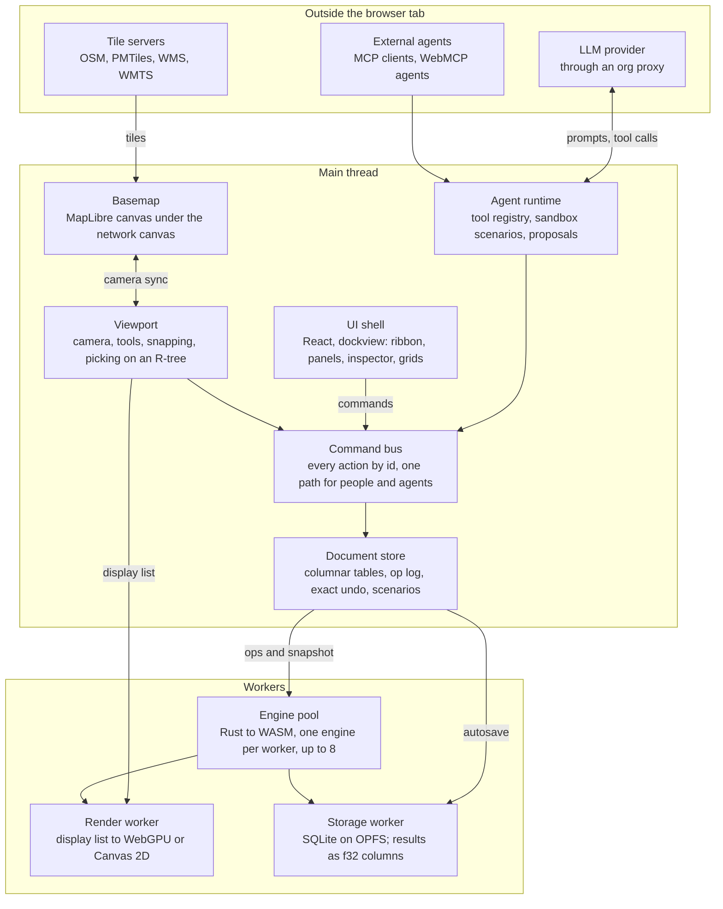

# WaterStudio: Web EPANET Design & Implementation Plan

Plan as of October 10, 2026. Living copy of the design document; architecture decisions that change it are recorded in docs/adr.

## Summary

WaterStudio (working name) is a local-first browser workbench that matches everything EPANET 2.2 and the OWA-EPANET 2.3 engine do, adds EPANET-MSX, and is built so an AI agent can design networks through the same commands a person uses. It follows PowerStudio's proven shape: a Rust engine compiled to WebAssembly in a worker pool, a backend-neutral display list drawn by WebGPU with a real Canvas 2D fallback, and oracle-checked numerics.

The plan reaches hydraulic parity in about 3 months, full EPANET 2.2 GUI parity in 6, a 1.0 with MSX, scenarios and agent proposals in 9, and agent design workflows (1.1) by month 12, with a team of about 9.

| Decision | Choice | Why |
| --- | --- | --- |
| Engine | Rust workspace, building on a fork of the MIT/Apache [epanet-rs](https://github.com/vitens/epanet-rs) hydraulic core (ADR 0001) and adding rules, leakage, energy, water quality and MSX | Numerical parity with EPANET 2.3 is its design goal; it already uses faer sparse algebra |
| Correctness oracle | OWA-EPANET 2.3.x (MIT, C) built natively in CI, never shipped | Every result is diffed against the reference engine, as PowerStudio diffs against MATPOWER and pandapower |
| Concurrency | Worker pool, one engine per worker; optional wasm threads only when the page is cross-origin isolated | Works on static hosting with no SharedArrayBuffer; fire flow and criticality are embarrassingly parallel |
| Rendering | One display list, three backends: WebGPU (WGSL SDF instancing), Canvas 2D, SVG/DXF/PDF export | WebGPU is in all major browsers but still missing on some Linux and Firefox platforms |
| Basemap | MapLibre GL JS under the network canvas, synced camera; OSM raster by default, self-hosted PMTiles for offline | OSM's tile policy forbids prefetch and offline use of tile.openstreetmap.org |
| UI shell | TypeScript, React for the shell only, dockview for closable/floating panels; editor core and renderer framework-free | Docking, virtual tables and accessible primitives come ready-made; hot paths stay out of React |
| Document | Columnar entity tables + transactional op log (exact undo/redo), project file as SQLite in OPFS | Scales to 100k+ elements; one-file projects as desktop users expect; ops double as agent changesets |
| AI agents | One typed tool registry over the command bus, exposed in-app, as an MCP server (2026-07-28 spec) and via WebMCP; agents work on a sandbox scenario and propose diffs a human accepts | Every agent action is undoable, attributable and verified by the engine, not by the model |
| Licence | MIT OR Apache-2.0, clean-room from epanet-js (FSL-1.1) | Lets us contribute upstream to epanet-rs and OWA; avoids FSL contamination |

## Scope: what "complete EPANET" means

"Complete" is defined as the EPA EPANET 2.2 GUI's feature set, the OWA-EPANET 2.3.x engine (the latest release is v2.3.5), and EPANET-MSX 2.0. EPA still ships 2.2 as its official release; 2.3 is the community engine the GUI has never exposed. Everything in the left column is release-blocking for 1.0; the right column is what makes it a professional tool.

| Area | Parity with EPANET (must have) | WaterStudio additions |
| --- | --- | --- |
| Network objects | Junctions, reservoirs, tanks (volume curves, overflow, 4 mixing models), pipes (open, closed, check valve), pumps (1-point, 3-point, multi-point, constant power, speed patterns, efficiency and price), valves PRV PSV PBV FCV TCV GPV and the 2.3 PCV, emitters, map labels | Hydrants, isolation valves as point features on pipes, meters, sensors; user attributes on every element |
| Data objects | Time patterns, curves (pump, efficiency, volume, headloss, valve), simple controls, rule-based controls (enable/disable in 2.3), demand categories, quality sources (concentration, mass booster, setpoint, flow-paced), reactions (bulk/wall order, limiting concentration, roughness correlation) | Visual pattern and curve editors with fitting, a rule editor with syntax checking and simulation of a rule's firing |
| Hydraulics | Extended-period and single-period runs; Hazen-Williams, Darcy-Weisbach, Chezy-Manning; demand-driven and pressure-driven demand; FAVAD pipe leakage; uni- or bidirectional emitters; demand, supplied, deficit, emitted and leakage outflow breakdown; flow and mass balance in the status report | Fire flow, pipe criticality, valve isolation segments, Monte Carlo demand runs, all fanned out across workers |
| Water quality | Chemical, water age, source trace; bulk and wall reactions with mass-transfer limits; tank mixing models | EPANET-MSX 2.0: multi-species bulk and wall kinetics, equilibrium species, dispersion |
| Energy | Pump energy, efficiency, cost, demand charge; energy report | Energy balance and pump-schedule what-ifs |
| Map editing | Add, move, delete, vertex editing, auto-length, group edit by region, find, map query, backdrop image, overview map, labels, flow arrows, colour coding with legends | CAD snapping and guides, split and merge pipes, reverse, orthogonal and street-following routing, OSM basemap, CRS-aware coordinates, topology checks |
| Results | Status, energy, calibration, reaction and full reports; time-series, profile, contour, frequency and system-flow graphs; network and time-series tables with filters; map animation through time | Scenario comparison with difference maps, run log with content hashes, pressure-variability and criteria-violation views, printable study report |
| Files | .inp read and write (lossless round-trip), EPANET binary .out, .rpt, .map coordinates, scenario (.scn) files, calibration (.dat) files, DXF and image export | GeoJSON, Shapefile, GeoPackage, DXF and CSV import with field mapping; one-file .wsproj; a C toolkit API compatible with EPANET 2.3 |
| Design and AI | — | Agent-assisted layout, sizing, calibration and review against a design-criteria profile, all through proposals a person accepts |

Out of scope for 1.0: transient (surge) analysis, real-time SCADA links in the style of EPANET-RTX, and multi-user live editing. The op-log design leaves room for the last two.

## Research findings

The ingredients exist separately but nobody has combined them: there is a Rust EPANET hydraulic solver, browser EPANET apps on the C engine, a cross-platform GUI with 2.3 and MSX, and a reference architecture for a Rust/WebGPU engineering workbench. The gap WaterStudio fills is all of them together, with agent design built in.

| Prior work | What it is | What we take | What we avoid |
| --- | --- | --- | --- |
| [EPA EPANET](https://www.epa.gov/water-research/epanet) | Public-domain Windows GUI, official release still 2.2 (2020); toolkit, MSX and RTX extensions | The feature set and the user's mental model: browser, map, property editor, reports | Its dated, modal UI and Windows-only reach |
| [OWA-EPANET](https://github.com/OpenWaterAnalytics/EPANET) 2.3.x | MIT C engine; 2.3 released July 2025, latest v2.3.5 ([QGISRed](https://qgisred.upv.es/en/integration-of-epanet-toolkit-version-2-3/)): FAVAD leakage, PCV, bidirectional emitters, new units, outflow breakdown, enable/disable rules | The reference engine for parity tests, and its regression networks | Shipping C in the product (the brief asks for a Rust engine) |
| [epanet-rs](https://docs.rs/crate/epanet-rs/latest) (Vitens) | Rust re-implementation of the 2.3 hydraulic solver, v0.2.3 July 2026, MIT/Apache, faer sparse solver; DDA, PDA, controls, emitters done; rules, leakage, energy and quality not yet | The hydraulic core as a dependency or fork, contributing the missing parts upstream | Its EPS-parallel mode as a default: it applies only without tanks or controls |
| [epanet-js](https://github.com/epanet-js/epanet-js) | Next.js web app on Placemark, C engine compiled to WASM, local-first; FSL-1.1-MIT licence | Proof that engineers adopt a browser EPANET; local-first SQLite projects | Reading or adapting its code: FSL forbids competing use for two years |
| [EPANET-UI](https://sites.google.com/view/epanet-ui) v1.0.4 | Cross-platform desktop GUI on OWA 2.3 with full MSX, shapefile/DXF/CSV import, web basemaps, fire flow and pressure variability reports | Confirms the report set professionals now expect beyond EPA's | Desktop install; no browser, no agents |
| [PowerStudio](https://github.com/swiftugandan/powerstudio) | MIT power-system workbench: Rust engine to WASM in workers, WebGPU SDF renderer with Canvas 2D fallback, ribbon, command palette, oracle-checked numerics, run records with hashes | The architecture nearly whole: core with no DOM, display list, store with exact undo, worker pool with edit forwarding, deterministic build | Its JSON document tree at national scale (324 MB at 70k buses); we use columnar binary instead |
| [LLM-EPANET](https://arxiv.org/abs/2503.16191) and [EPANET-Agentic](https://library.kwrwater.nl/publication/110315) | Research agents that drive EPANET from natural language; multi-agent with human-in-the-loop, reported up to 90% and 100% task success | Planner, modeler, analyst and checker roles; human oversight on critical changes | Generating free-form Python against the toolkit; we give agents typed, validated tools |

**Platform state, October 2026.** WebGPU ships in Chrome, Edge, Safari 26 and Firefox, but Firefox only on Windows and Apple Silicon and Chrome on Linux only on recent GPUs ([status](https://app.cinevva.com/guides/webgl-webgpu-not-supported-fix)), so Canvas 2D must be a first-class path. MapLibre GL JS v6 shipped in July 2026 and its WebGPU path is still in progress, so the basemap runs in its own WebGL canvas ([newsletter](https://maplibre.org/news/2026-08-02-maplibre-newsletter-jul-2026/)). MCP's 2026-07-28 spec made the protocol stateless ([release](https://github.com/modelcontextprotocol/specification/releases/tag/2026-07-28)). WebMCP is a W3C Community Group draft whose API moved from navigator.modelContext to document.modelContext in July 2026 ([overview](https://mcpplaygroundonline.com/blog/what-is-webmcp)), so it stays behind feature detection.

**Map tiles.** The [OSM tile policy](https://operations.osmfoundation.org/policies/tiles/) requires visible attribution and a valid Referer, and forbids prefetching and offline downloads from tile.openstreetmap.org. Offline maps therefore come from self-hosted vector tiles (PMTiles), and the tile source is a setting, not a constant.

## System architecture

The main thread only edits and displays: the engine, the renderer and storage each run in their own workers, so a 100,000-pipe network or a long fire-flow study never freezes the page. The command bus is the one door every change goes through, whether it comes from a click, a shortcut or an agent.



The UI, the viewport and the agent runtime all write through the command bus into the document store, which forwards ops to the engine pool and autosaves to storage. The engine hands result slices to the render worker for the map and full result columns to storage for charts and tables.

Repository layout (pnpm workspaces plus one Cargo workspace):

```text
waterstudio/
  engine/                 Rust workspace: ws-model, ws-io, ws-sparse, ws-hyd, ws-energy,
                          ws-qual, ws-msx, ws-study, ws-wasm, ws-ffi, ws-cli
  packages/core/          document model, catalogue, store, scenarios, query language (no DOM)
  packages/render/        geometry, display list, WebGPU, Canvas 2D, SVG/DXF/PDF backends
  packages/engine-client/ worker pool, protocol types generated from Rust
  packages/agents/        tool registry, sandbox sessions, proposals, provider adapters
  packages/ui/            design tokens, icons, ribbon, dockview panels, inspector, grids, charts
  packages/symbols/       engineering symbol masters (SVG) and their catalogue, shared by renderer and exports
  apps/web/               the app (Vite build, PWA, single-file offline build)
  apps/mcp-server/        headless MCP server over the same registry and engine
  oracle/                 OWA-EPANET 2.3.x and EPANET-MSX built natively for CI comparison
  corpus/                 test networks and golden results
```

## Rust computational engine

The engine is a Cargo workspace that reproduces EPANET 2.3's algorithms step for step, so results match the reference to within its own tolerances, and compiles both to wasm32 (SIMD128) and to a native CLI. It holds no UI state and never reads coordinates except for auto-length and GIS tools.

| Crate | Responsibility |
| --- | --- |
| ws-model | Canonical network in struct-of-arrays form, stable internal handles, validated operations with inverses, content hash that ignores drawing data |
| ws-io | .inp parser and writer (lossless round-trip, comments kept), EPANET .out and .rpt writers, .msx parser, GeoJSON bridge |
| ws-sparse | SparseSolver trait over faer: symbolic Cholesky with AMD ordering once per topology, numeric factorisation each iteration; dense reference solver for tests |
| ws-hyd | Global Gradient Algorithm (Todini and Pilati), from epanet-rs: headloss formulas, minor losses, pumps, all valve types including PCV, check valves, DDA and PDA, FAVAD leakage, emitters, tanks, simple controls, rules, time stepping |
| ws-energy | Pump energy, efficiency, cost and demand charge, as in the energy report |
| ws-qual | (in ws-solver, ADR 0006) Lagrangian time-driven segment method: chemical, age, trace; bulk and wall kinetics with mass transfer; complete-mix, two-compartment, FIFO and LIFO tanks |
| ws-msx | MSX 2.0: expression compiler to a bytecode VM (no eval, CSP-safe), Euler, adaptive RK5 and Rosenbrock integrators, Newton for equilibrium species, dispersion |
| ws-study | Fire flow, criticality, isolation segments, Monte Carlo, calibration (Levenberg-Marquardt), pipe sizing search, run reports and hashes |
| ws-wasm | The only crate with unsafe: ws\_alloc, ws\_free, ws\_call over binary envelopes |
| ws-ffi | C API compatible with the EPANET 2.3 toolkit (EN\_ functions), so existing scripts and EPyT-style wrappers can link to it |
| ws-cli | ws run, ws validate (against OWA-EPANET), ws bench, and the engine behind the headless MCP server |

**Numerical rules.** Internal units are EPANET's (feet, cfs, psi), converted only at the boundary, so rounding follows the reference. Convergence criteria, damping, status checks and the valve state machine copy 2.3 exactly, including CHECKFREQ, MAXCHECK and DAMPLIMIT. Output order never depends on hash iteration, and reductions run in a fixed order, so a run is bit-identical across instances.

**WASM boundary.** Messages are postcard-encoded structs whose TypeScript types are generated from Rust, so the two sides cannot drift. Results come back as raw f32 columns in transferable ArrayBuffers, never as JSON. The worker API is small:

```ts
type EngineRequest =
  | { kind: 'open'; snapshot: ArrayBuffer }          // whole model, once
  | { kind: 'edit'; rev: number; ops: ArrayBuffer }  // op log deltas after that
  | { kind: 'run'; expectRev: number; study: Study; options: RunOptions }
  | { kind: 'slice'; run: RunId; variable: Var; step: number }      // one map frame
  | { kind: 'series'; run: RunId; variable: Var; ids: Uint32Array }; // chart data
```

**Parallelism.** The pool runs one engine per worker, up to min(cores − 1, 8), capped by device memory. Fire flow, criticality, segments and Monte Carlo split into chunks that are handed out as workers free up, then merged in chunk order so the result equals the sequential one. When the page is cross-origin isolated, an optional threads build runs rayon inside one engine for very large single runs; the default build needs no SharedArrayBuffer.

**Verification.** CI builds OWA-EPANET 2.3.x natively as the oracle and runs both engines on a corpus: EPANET's Net1 to Net3 and example networks, the OWA regression suite, the Kentucky KY networks, Anytown, C-Town, L-Town and the MSX examples. Starting tolerances, tightened as reached: heads within 0.001 ft, flows within 0.01% relative, identical control and status event sequences, quality within 0.1% or 0.001 mg/L, water age within 0.01 h. Property tests check .inp round-trips, cargo-fuzz runs the parsers, and the same suite runs native and WASM builds against each other.

## Document model, persistence and scenarios

One transactional op log is the spine of the app: the editor writes it, undo replays it, the engine applies it, autosave persists it, scenarios layer it, and agents propose it. Getting this right first removes whole classes of bugs later.

**Entity tables.** Each element class (junction, tank, pipe, pump, valve, and so on) is a columnar table: typed arrays for numbers and node references, a string table for EPANET IDs (31-character limit enforced on export), and sparse maps for user attributes. Each element has a stable u32 handle that is never reused, so renames, undo and agent references stay valid. Field specs (type, unit, limits, help text, which alternative a field belongs to) live in one catalogue that the inspector, the data grid, import mapping, validation and the agent tool schemas all read.

**Store.** All changes go through `store.transact()`, which records each op with the value it replaced; undo and redo are exact, and a drag or a typed field coalesces into one step. Each op serialises to a compact binary form used for engine forwarding, autosave and agent changesets alike. Results carry the revision they were computed at and turn stale on any later edit.

**Scenarios.** A project is a base network plus alternatives in six families: physical, demand, operational (controls, rules, settings), initial conditions, quality, and options. A scenario picks one alternative per family, and alternatives can inherit from a parent. Edits route to the active alternative by the field's family, as PowerStudio routes edits to variants and scenarios. The scenario manager shows inheritance as a tree and compares any two scenarios on the map and in tables.

**Project file.** A project is one SQLite database (the official sqlite-wasm build on OPFS) owned by a dedicated storage worker: entity column chunks, the op log, alternatives, scenarios, GIS layers, the run log and agent sessions. Saving is incremental. The same file downloads as .wsproj, and any scenario exports as a standard .inp (plus .msx) that EPANET 2.2 and 2.3 open.

**Results.** Each run writes columns of f32 (variable × time step × element) in chunks to OPFS rather than memory: 50,000 links × 97 steps × 8 variables is about 155 MB. A map frame reads one slice of a few hundred kilobytes; a chart gathers one element's series. Each run record stores the hashes of the model, options, engine binary and results, so any result can be reproduced and audited.

**Later, not now.** Ops carry hybrid logical clock stamps so multi-user sync can be added without changing the format.

## CAD canvas and rendering

The canvas draws one backend-neutral display list with WebGPU when it can and Canvas 2D when it cannot, so every feature works on both and exports come from the same source. Result colouring is a per-element scalar looked up in the shader, so stepping or animating through time rewrites one buffer and rebuilds nothing.

**Display list.** Four layers: static geometry (links as polylines, nodes as symbols, map labels), result encoding (one scalar per element per variable), annotations (ID and value labels, legends, flow arrows), and an overlay rebuilt on every pointer move (selection, hover, handles, snap guides, tool preview). Geometry is in world coordinates in growable Float32 buffers; the CPU keeps f64 positions and the GPU receives camera-relative f32, so there is no jitter at street zoom.

**WebGPU backend.** Pipe segments are instanced quads whose round caps and joins come from signed-distance functions in WGSL, with width set in screen pixels. Node and link symbols are instanced from a multi-channel SDF symbol atlas and rotate to the link's bearing. Flow arrows are instanced along each link with direction from the sign of the flow. Colours come from a colormap texture indexed by the element's value and the legend breaks. Text uses an MSDF glyph atlas; the frame renders with 4× MSAA.

**Canvas 2D backend.** The same list, drawn in an OffscreenCanvas in a render worker. Links are batched into one Path2D per legend class (EPANET's default legend has five), so draw calls scale with classes, not elements. Below a pixel threshold, node symbols drop to dots and labels thin out. If the GPU device is lost, the viewport swaps to Canvas 2D and the status bar badge says which backend runs and why.

**Picking and spatial index.** Hit testing runs on CPU geometry through a packed R-tree (flatbush) built per revision plus a small dynamic grid for edits since, so it never depends on the backend or GPU readback.

**Map and coordinates.** A project has a CRS (any EPSG code through proj4js) or is schematic with no CRS. With a basemap on, MapLibre GL JS draws in a canvas underneath and our canvas sits on top; our camera controller is the single source of truth and calls `jumpTo` on MapLibre each frame. Basemap sources are settings: OSM standard tiles (attribution shown, no prefetch), vector tiles from OpenFreeMap or a self-hosted PMTiles file for offline work, the user's own XYZ, WMTS or WMS imagery, and EPANET-style georeferenced backdrop images. OSM street centrelines, loaded on request for the area in view, serve as snapping guides and as routes for agent layouts; anything derived from them carries ODbL attribution.

**CAD interactions.** Snapping to nodes, vertices, midpoints, perpendiculars, street centrelines, grid and 15° angles; ortho mode; dynamic input for typed lengths and bearings; drawing a polyline pipe inserts junctions where it crosses or ends; dropping a node on a pipe splits it; merge, reverse and reconnect; window and crossing selection, lasso, and saved selection sets; a measure tool. Every gesture is one transaction, and Esc reverts a cancelled drag.

**Engineering symbols.** One SVG master per symbol on a 24-unit grid, compiled to the SDF atlas, SVG export and DXF blocks. Glyphs follow ISO 14617 and ISO 10628-2 conventions while staying close to what EPANET users already read.

| Element | Symbol |
| --- | --- |
| Junction | Filled circle, size by zoom |
| Reservoir | Open-top rectangle with a waterline |
| Tank | Rectangle with level indicator, fill shows current level during playback |
| Pump | Circle with a triangle pointing downstream |
| General valve, TCV, GPV, PCV | Two triangles tip to tip (bow-tie), with a letter tag for the type |
| PRV, PSV, PBV | Bow-tie with a pressure actuator and a sensing line on the controlled side |
| FCV | Bow-tie with a flow tag |
| Check valve (pipe status CV) | Bow-tie with one half filled and an arrow |
| Isolation valve on a pipe | Small bow-tie on the line, filled when closed |
| Emitter, hydrant | Spray mark on the junction; hydrant post symbol |
| Sensor, meter | Circle with an instrument tag, ISA 5.1 style |

## UI/UX: workspace, ribbon and panels

The workspace reads like a desktop engineering tool (ribbon, docked panels, status bar) but behaves like a modern app: every action is a command reachable from the ribbon, the palette, a shortcut, a context menu or an agent, and every panel can be closed, moved, floated or popped out to a second screen.

**Layout.** Title bar with project, active scenario chip and run status; ribbon; left dock with Model Browser and Layers; centre with the map/CAD canvas, which splits into side-by-side views (geographic and schematic, or two scenarios); right dock with Properties and the AI Assistant; bottom dock with Results Tables, Charts, Messages and Validation; status bar with cursor coordinates and CRS, snap state, units, renderer badge, and engine status and memory. Panels use dockview: closable, draggable, floating and pop-out, with layout presets (Build, Analyse, Review, Agent) saved per user and a View menu that reopens anything closed.

**Ribbon.** Tabs collapse groups into dropdowns as the window narrows, carry Office-style key tips (Alt, then letters), and the ribbon itself folds to tabs only. Contextual tabs appear with their selection.

| Tab | Groups |
| --- | --- |
| Home | Clipboard, Undo/Redo, Select (window, crossing, lasso, by query), Find, Scenario switcher, Run |
| Draw | Nodes (junction, reservoir, tank), Links (pipe, pump, valve by type), Annotate (label, text, dimension), Edit (split, merge, reverse, reconnect, vertices), Snap and ortho |
| Data | Patterns, Curves, Controls, Rules, Demand categories, Sources, Reactions, MSX species and reactions, Element catalogue (pipe materials, pump library) |
| Analysis | Options (hydraulic, quality, times, energy, report), Run EPS or single period, Quality, MSX, Fire flow, Criticality, Segments, Monte Carlo, Calibration |
| Results | Map theme (variable, legend, arrows, labels), Time player, Graphs (time series, profile, contour, frequency, system flow), Tables, Reports (status, energy, calibration, reaction, full), Compare scenarios |
| Map | Basemap, CRS, Backdrop, Layers, Overview map, Measure, Street data |
| Tools | GIS import with field mapping, Elevations from DEM, Demand allocation, Validate topology, Skeletonise, Export (inp, msx, out, DXF, SVG, PDF, GeoJSON) |
| AI | Assistant, Agent tasks (layout, sizing, calibration, review), Proposals queue, Design criteria profile, Agent log |
| View | Panels, Layout presets, Theme, Density, Units, Command palette |
| Contextual | Pipe tools, Pump tools, Valve tools, Graph tools, Table tools |

**Inspector and data grid.** The Properties panel groups fields as the catalogue does, shows units, edits many selected elements at once (mixed values shown as such), validates inline, previews the element's pattern or curve, and shows its results with a sparkline. The data grid (TanStack Table with virtual rows) shows every element of a class as a spreadsheet: bulk set a column, paste a block from Excel (checked whole before anything changes), and filter with the same query language the map and the agents use, for example `pressure < 20 psi and zone = "North"`.

**Charts and time.** Time series, profile and frequency plots use uPlot for speed; contours are computed by marching squares over a triangulation of node values and drawn by the canvas. One time controller (slider, play, speed, step) drives the map and every chart together.

**Icons and visual language.** App icons build on Lucide (ISC licence) for generic actions, plus a custom set for hydraulic actions drawn on the same 24-pixel grid and stroke weight; the ribbon uses 32-pixel and 16-pixel sizes. Engineering symbols on the canvas are kept visually distinct from interface icons. A token-based design system defines colour, a 4-pixel spacing scale and type; light and dark themes and compact and comfortable densities ship. Default colour ramps are colour-blind safe (viridis, cividis), with EPANET's classic blue-to-red ramp as an option.

**Accessibility.** WCAG 2.2 AA, enforced by axe-core in CI in both themes. The canvas is keyboard operable (Tab cycles elements near the cursor, arrows nudge, Enter opens properties), the Model Browser is an accessible tree, runs and validation results are announced, and reduced motion stops animated arrows.

**First run.** Sample networks (Net1 to Net3, Anytown), an empty state that offers import or drawing, inline field help from the catalogue, and an agent that can explain any result in plain language.

## AI agent based design

Agents design through the same typed commands people use, on a sandbox scenario, and hand back proposals that the engine has verified and a person accepts. The language model plans and explains; the hydraulic engine and deterministic optimisers compute; nothing an agent does bypasses undo, validation or review.

**One tool registry, three surfaces.** Tools are declared once in TypeScript with JSON Schemas generated from the field catalogue, and each one wraps commands on the command bus.

- In-app Assistant panel: a provider adapter for Anthropic, OpenAI-compatible and local models. Organisations route calls through their own proxy so API keys never sit in the browser.
- MCP server: a Node CLI that loads the same registry and the WASM engine, speaking the stateless 2026-07-28 spec, so Claude Code and other agents can model headlessly on a .wsproj or .inp.
- WebMCP: when `document.modelContext` (or the older `navigator.modelContext`) exists, the open project registers its tools for in-browser agents, behind a setting.

| Tool family | Examples | Writes? |
| --- | --- | --- |
| Context | get\_project\_summary, get\_criteria, list\_scenarios | No |
| Query | query\_elements (map query language), get\_results\_slice, get\_timeseries, find\_violations | No |
| Edit | add\_nodes, add\_pipes\_along(path), set\_properties, split\_pipe, connect, delete\_elements | Draft only |
| Analyse | run\_hydraulics, run\_quality, run\_fire\_flow, run\_criticality, compare\_scenarios | No |
| Design | size\_pipes (optimiser), allocate\_demands, elevations\_from\_dem, layout\_from\_streets, calibrate | Draft only |
| Verify | check\_criteria, validate\_topology, explain\_run | No |
| Propose | submit\_proposal(changeset, rationale, evidence) | Queues for review |

```ts
export const sizePipes = defineTool({
  name: 'size_pipes',
  description: 'Choose diameters from a catalogue that meet the design criteria at least cost.',
  input: z.object({
    pipes: z.array(Handle).max(5000),
    catalogue: z.string(),                 // e.g. 'ductile-iron-metric'
    objective: z.enum(['cost', 'cost+energy']),
    loadCases: z.array(z.enum(['peak-hour', 'min-hour', 'max-day+fire'])),
  }),
  scope: 'draft',                          // refused outside an agent sandbox
  run: (args, ctx) => ctx.engine.study('pipe_sizing', args), // deterministic search in ws-study
});
```

**Sandbox and proposal loop.**

1. A task opens an agent session that forks a draft alternative from the active scenario.
2. The agent queries, edits the draft, and runs analyses as often as it needs.
3. Before it can submit, check\_criteria must pass or every remaining violation must be listed and explained.
4. A proposal is the changeset (ops), a rationale, and evidence: run hashes, before-and-after KPIs, criteria results.
5. The review panel shows a map diff (added, removed, modified), a table diff and KPI cards; the reviewer accepts all, accepts per item, rejects, or sends it back with a comment.
6. Accepted ops merge as one undoable transaction attributed to the agent session.

**Permissions.** Read-only, Propose (default) and Auto-apply, which is limited to named draft scenarios and a cap on elements changed. Deletions and any change to the base network always need a person.

**Design criteria profile.** A machine-checkable profile per project or zone: minimum and maximum pressure at peak and minimum hour, maximum velocity, maximum headloss gradient, fire flow at a residual pressure, tank turnover, water age, and minimum disinfectant residual. People and agents check against the same profile, and the defaults are left blank for the user to set to their local standard.

**Roles.** Following EPANET-Agentic, a session can run as a planner, a modeller, an analyst and a checker. The checker sees only the changeset, the criteria and the engine, never the producer's reasoning, so the work is not grading itself.

**Built-in design workflows.** Layout from streets (OSM centrelines in a drawn polygon become a candidate main network with junctions at intersections), elevations from a DEM, demand allocation from meters or building footprints, least-cost pipe sizing, fire-flow deficiency repair, calibration against field data, model QA review, and plain-language explanation of any result.

**Context engineering.** Agents never receive a whole network. Tools return summaries, statistics, top-k lists, spatial clusters and paged results addressed by stable handles, and a map snapshot is available to multimodal models.

**Safety and privacy.** Projects stay local; only what a tool returns is sent to the model, with an option to pseudonymise IDs and drop coordinates. Text from imported files and GIS attributes is treated as data, never as instructions. Agent tools cannot reach the network except through allowlisted services, and exports need a person's confirmation. The full agent log (prompts, tool calls, result hashes) is stored in the project.

**Evaluation.** A benchmark of design and analysis tasks on standard networks with deterministic graders (criteria met, cost, elements changed, tool errors) runs nightly per model and gates releases, the way LLM-EPANET measured accuracy by query type.

## Quality, performance and security

Every claim the app makes is backed by a test that runs in CI: numerics against OWA-EPANET, rendering by decoding screenshot pixels in each backend, accessibility by axe-core, and speed against the budgets below. A budget miss fails the build like a broken test.

| Budget | Target | Measured by | Measured in CI (Canvas 2D, ADR 0018) |
| --- | --- | --- | --- |
| Open and draw a 10,000-pipe .inp | under 1.5 s | Playwright, production build | 0.2 s |
| Pan and zoom, 200,000 links | 60 fps WebGPU; 30 fps or better on Canvas 2D with LOD | Frames the render worker reports | 54 fps (50,000 pipes: 50–58 fps) |
| Step or scrub one time step, 100,000 elements | under 16 ms | Paint plus the worker's draw | 4 ms average, 7 ms worst |
| 24-hour EPS, 10,000 nodes, 1-hour steps | under 2 s in one WASM worker | Engine worker, realistic network | 0.3 s (full grid: 1.0 s) |
| Fire flow at 1,000 hydrants, 10,000-node network | under 10 s on 8 workers | Study pool; budget scaled to its size | 16 s on 1 worker (budget 80 s) |
| Edit to repaint | under 50 ms; no main-thread task over 50 ms | Transaction to the worker's drawn frame, long-task observer | 20 ms, no long tasks |
| Memory, 100,000-element project with one EPS loaded | under 1 GB per tab | Resident size of the tab, after garbage collection | 449 MB (828 MB before collection) |

**Test layers.** Rust unit and oracle tests; native versus WASM comparison; Vitest for the core and store; Playwright in four projects (Chromium with WebGPU, Chromium without it to force Canvas 2D, Firefox, WebKit) covering drawing, snapping, import, runs, undo, docking and the agent review flow; screenshot pixel checks per backend; nightly agent evaluations.

**Security.** A Content-Security-Policy whose connect-src lists only the configured tile hosts and LLM proxy; `'wasm-unsafe-eval'` and nothing else; Trusted Types required; no eval anywhere (MSX expressions run in the bytecode VM). Projects can be exported encrypted (AES-256-GCM, key from Argon2id), as PowerStudio does. The engine build is reproducible and its hash appears in every run record; releases ship a CycloneDX SBOM and signed provenance.

**Delivery.** A static site installable as a PWA, whose service worker caches the app shell and engine for offline use, plus a single self-contained HTML build for air-gapped utilities. No account is needed to model; sign-in exists only for organisation-managed AI and, later, sharing.

## Implementation roadmap

The build runs in five phases with a hard gate at the end of each; hydraulics come first because every other feature, the agents included, depends on a trusted engine. The agent tool registry starts in month 2, as soon as commands exist, so agents grow with the product rather than being bolted on.

```mermaid
gantt
  title Hydraulic alpha at month 3, EPANET parity at 6, 1.0 at 9
  dateFormat X
  axisFormat M%s
  section Phases
  0 Foundations          :0, 1
  1 Hydraulic alpha      :1, 3
  2 EPANET parity beta   :3, 6
  3 Pro 1.0              :6, 9
  4 Agent design 1.1     :9, 12
  section Parallel
  Agent track            :2, 12
  section Gates
  Alpha :milestone, 3, 0
  Beta  :milestone, 6, 0
  1.0   :milestone, 9, 0
  1.1   :milestone, 12, 0
```



Each gate is pass or fail against the criteria in the table; a phase that misses its gate does not start the next one's risky work.

| Phase | Delivers | Exit gate |
| --- | --- | --- |
| 0 Foundations | Monorepo and CI; OWA-EPANET oracle harness and network corpus; .inp round-trip; design tokens; icon and symbol masters; architecture decision records | .inp round-trip is lossless on every corpus file; oracle pipeline runs green |
| 1 Hydraulic alpha | ws-hyd with rules, leakage and energy; worker pool; store with undo; WebGPU and Canvas 2D renderer; ribbon and docking shell; draw, edit, run, colour the map | Hydraulics within tolerance on the whole corpus; a 50,000-pipe network pans within budget on both backends |
| 2 EPANET parity beta | ws-qual; every EPANET report, graph and table; time player; MapLibre basemap and CRS; GIS and DXF import and export; backdrop; .out and .rpt; read-only agent tools and the Assistant | Every EPANET 2.2 GUI function checked off; quality within tolerance; WCAG audit passes |
| 3 Pro 1.0 | ws-msx; scenario manager; fire flow, criticality, segments; DEM elevations; demand allocation; SQLite project file; C toolkit API; CLI; proposal and review UI; MCP server | MSX examples within tolerance; every performance budget met; agent evaluation baseline recorded |
| 4 Agent design 1.1 | Layout from streets, pipe sizing optimiser, calibration, fire-flow repair, independent checker, WebMCP, nightly agent evaluations as a release gate | Agent tasks meet the agreed pass rate, with no criteria violations in accepted proposals |

| Team role | People | Owns |
| --- | --- | --- |
| Rust numerics engineers | 2 | ws-hyd, ws-qual, ws-msx, ws-study, the oracle |
| Graphics engineers | 2 | Renderer backends, map integration, CAD interactions, exports |
| Front-end engineers | 2 | Shell, ribbon, panels, inspector, grids, charts, storage |
| Agent engineer | 1 | Tool registry, sandbox sessions, proposals, MCP, evaluations |
| Product designer | 1 | Design system, icons, symbols, usability sessions with engineers |
| QA and developer tooling | 0.5 to 1 | CI matrix, Playwright, benchmarks, releases |
| Hydraulic engineer advisor | part-time | Test cases, criteria presets, acceptance of each gate |

## Risks and open decisions

The largest risk is numerical, not visual: water quality and MSX parity take longer than hydraulics, so they start early and are measured weekly against the oracle.

| Risk | Likelihood | Impact | Mitigation |
| --- | --- | --- | --- |
| Quality and MSX parity drift (segment handling, tank mixing, integrator steps) | High | High | Port by module with oracle tests per reaction case; keep the C engine as a CI oracle; contingency: ship 1.0 with an MSX preview flag |
| epanet-rs diverges from our needs or stalls | Medium | Medium | Depend on a pinned fork, upstream changes continuously, own the solver if needed (MIT/Apache permits it) |
| WebGPU gaps on Linux and older GPUs | High | Low | Canvas 2D is a first-class backend with its own tests and budgets |
| Memory on very large EPS runs | Medium | High | Columnar f32 results in OPFS, slices on demand, memory-aware pool sizing |
| FSL contamination from epanet-js | Low | High | Clean-room rule: contributors do not read its source; provenance noted in PRs |
| OSM tile policy or provider changes | Medium | Medium | Tile sources are settings; self-hosted PMTiles path; no prefetch from OSM |
| Agents propose unsafe or wrong designs | Medium | High | Draft-only edits, criteria check before submit, independent checker, human acceptance, full log |
| MCP and WebMCP spec churn | High | Low | Thin adapters over one registry; WebMCP behind feature detection |

Open decisions for the first planning meeting:

- [ ] Product name and licence confirmation (MIT OR Apache-2.0 proposed)
- [ ] Fork epanet-rs, or depend on it and contribute upstream
- [ ] Default design criteria presets per region, or always user-defined
- [ ] Hosted LLM proxy offered by us, or bring-your-own only
- [ ] Which pipe and pump catalogues ship by default

## Sources

- [EPANET, US EPA](https://www.epa.gov/water-research/epanet)
- [OWA-EPANET on GitHub](https://github.com/OpenWaterAnalytics/EPANET)
- [QGISRed: integration of EPANET Toolkit 2.3](https://qgisred.upv.es/en/integration-of-epanet-toolkit-version-2-3/)
- [EPyT v2.3.3.0 release notes (2.3 API list)](https://github.com/OpenWaterAnalytics/EPyT/releases/tag/v2.3.3.0)
- [EPANET-MSX 2.0 manual](https://epanetmsx2manual.readthedocs.io/en/latest/1_introduction.html)
- [epanet-rs 0.2.3 (Vitens)](https://docs.rs/crate/epanet-rs/latest)
- [epanet-js app repository](https://github.com/epanet-js/epanet-js) and [epanet-js library](https://github.com/modelcreate/epanet-js)
- [Tom MacWright on epanet-js and Placemark](https://macwright.com/2025/07/03/epanet-placemark)
- [EPANET-UI](https://sites.google.com/view/epanet-ui)
- [PowerStudio README](https://github.com/swiftugandan/powerstudio) and [ARCHITECTURE.md](https://raw.githubusercontent.com/swiftugandan/powerstudio/main/docs/ARCHITECTURE.md)
- [LLM-EPANET (arXiv 2503.16191)](https://arxiv.org/abs/2503.16191)
- [EPANET-Agentic, Water Research 293 (2026)](https://library.kwrwater.nl/publication/110315)
- [OSM tile usage policy](https://operations.osmfoundation.org/policies/tiles/)
- [MapLibre newsletter, July 2026](https://maplibre.org/news/2026-08-02-maplibre-newsletter-jul-2026/) and [PMTiles for MapLibre](https://docs.protomaps.com/pmtiles/maplibre)
- [WebGPU and WebGL support, September 2026](https://app.cinevva.com/guides/webgl-webgpu-not-supported-fix)
- [MCP specification 2026-07-28 release](https://github.com/modelcontextprotocol/specification/releases/tag/2026-07-28)
- [WebMCP API status, 2026](https://mcpplaygroundonline.com/blog/what-is-webmcp)
